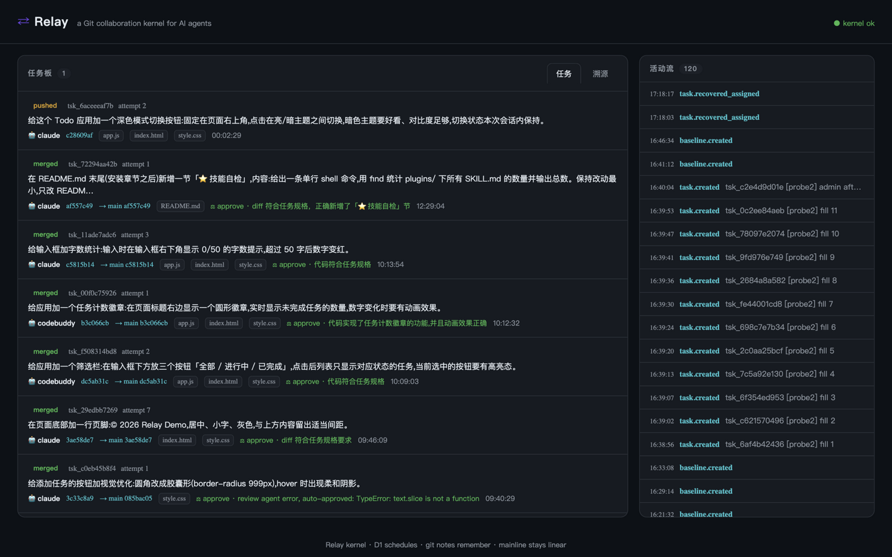

# Relay

**A Git collaboration kernel for AI agents.**

[中文](README.md) · Demo video: [docs/relay-demo.mp4](docs/relay-demo.mp4)



Relay runs on Cloudflare Workers + [Artifacts](https://developers.cloudflare.com/artifacts/) and reimplements how changes are made to a codebase when the primary committers are AI agents — not humans.

> Traditional GitHub's primitives — repo, branch, pull request — are designed around human attention and trust.
> Relay's primitives are **fork-per-task, merge scheduling, provenance**: designed around the economics of agents —
> attention is nearly free, context is expensive and ephemeral, concurrency is extreme, and trust must be auditable.

## Design principles

1. **Isolation first** — every task forks its own workspace repo with a short-lived repo-scoped write token. No shared branch queues, no big-diff hotspots. Cloudflare Artifacts' own best practice: "if you have ten thousand agents, open ten thousand repos."
2. **Conflict is a scheduling problem, not a code problem** — the platform schedules merges by each task's touch-set: mainline untouched → fast-forward; touched but disjoint files → cherry-pick replay; **overlapping → auto re-fork onto the new baseline and hand the task back to an agent**. For an agent, redoing on a fresh baseline is cheaper than a three-way merge — the context is still there, redo is mechanical.
3. **The repo is the memory** — agent sessions are stateless. Task specs, review verdicts, remediation instructions and execution metadata persist as git notes on commits; any agent (possibly from another vendor) can resume from the repo.
4. **Provenance first** — every merged commit can answer: which agent, which model, under which spec, what the review said, how many redo rounds.

## Trust model: three deterministic gates + one human gate

Daily use requires trusting the platform with a real project, so review is layered — mechanical first, semantic last:

1. **Policy gate (kernel, deterministic)** — per-task `allow`/`deny` globs (gitignore-style), `max_files`, `max_diff_bytes`; a built-in deny list (`.env*`, keys, CI workflows) always applies. Violations reject with machine-generated instructions; no model involved.
2. **Local-check gate (runner, deterministic)** — after push, the runner runs `npm test`/`lint` from the **fork base's** package.json against the agent's tree (deleting the test script cannot escape the gate). Non-zero exits reject deterministically.
3. **AI review gate (Workers AI, semantic)** — structured verdict against the spec. **Fail-closed**: model errors or unparseable output suspend the task for a human, never auto-approve.
4. **Human gate (optional)** — `needs_human_review: true` suspends even after AI approval; a one-click approve/reject on the dashboard (a reject note becomes the next remediation instruction).

## Quickstart

Prerequisites: Node 20+ (24+ for resident mode), a Cloudflare account with Workers Paid + Artifacts enabled, wrangler 4.149+.

```bash
cd kernel && npm install
npx wrangler d1 create relay-kernel          # put database_id into wrangler.jsonc
npx wrangler d1 execute relay-kernel --remote --file schema.sql
openssl rand -hex 24 | npx wrangler secret put RELAY_TOKEN         # admin
openssl rand -hex 24 | npx wrangler secret put RELAY_SUBMIT_TOKEN  # optional: submit-only token
npx wrangler deploy                          # → https://<your>.workers.dev

cd ../runner
node bin/relay-runner.mjs config https://<your>.workers.dev <RELAY_TOKEN>

# onboard an existing repo (pushes committed history, never touches your working tree)
node bin/relay-runner.mjs attach --dir /path/to/your-repo --repo your-repo

# submit a task in one line
node bin/relay-runner.mjs task "Add a dark-mode toggle" \
  --baseline your-repo --allow "src/**,styles/**"

# drive an agent + merge (or install the resident service, see deploy/)
node bin/relay-runner.mjs work --agent claude --once
node bin/relay-runner.mjs merge --once        # the merge loop self-drives /schedule

# pull merged mainline back into your local repo (--push also pushes GitHub)
node bin/relay-runner.mjs sync --repo your-repo --dir /path/to/your-repo [--push]
```

Dashboard: `https://<your>.workers.dev/` (enter the admin token; needs_human tasks get one-click approve/reject).

Notes for restricted networks: the runner auto-detects a local proxy (7897/7890/7891/1087/8118) when the kernel is unreachable directly; disable with `RELAY_NO_PROXY=1`, or set `NODE_USE_ENV_PROXY=1` + `https_proxy` manually.

## Tokens

| Token | Powers | For |
|---|---|---|
| `RELAY_TOKEN` (admin) | everything: schedule, merge, claim, human review, bootstrap | operator / the runner |
| `RELAY_SUBMIT_TOKEN` (optional) | submit tasks + read-only views; everything else 401 | team members |

Without `RELAY_SUBMIT_TOKEN` behavior is single-token. Submit tokens carry abuse guards: ≤50 open tasks per baseline, ≤12 creations/minute (atomic two-bucket sliding window). Fork write tokens stay short-lived (45min).

## Tests

```bash
node --test kernel/test/logic.test.ts runner/test/*.test.mjs     # unit (pure logic)
cd kernel && node test/integration.mjs --url ... --token ...     # 14-case live suite
```

## License

MIT
